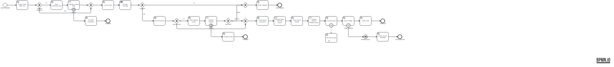
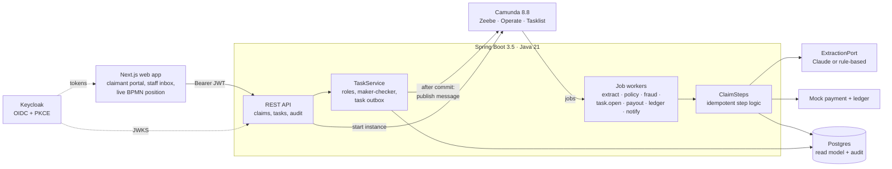

# ClaimFlow

**Insurance claims orchestration on Camunda 8.** A claim document comes in and AI extracts the fields. Rules and fraud checks decide the route, adjusters handle the exceptions, and a payout needs two different people to release it.

[](https://github.com/sudo-tafadzwa/claimflow/actions/workflows/ci.yml) · MIT licence · Java 21 · Spring Boot 3.5 · Camunda 8.8 · Next.js 16



### Why the engineering is interesting

- **AI proposes, it never decides.** An LLM extracts fields from the document with a confidence for each one. If any required field is uncertain, the claim goes to an adjuster before any rule runs, and every value is re-checked in code. An evaluation set measures the error that matters: being **confidently wrong**.
- **The process is the source of truth.** One BPMN model and one DMN table drive everything, including SLA timers that escalate stalled work, and **compensation** that reverses a payout when the ledger rejects it.
- **Controls a regulated business would accept.** Keycloak roles, maker-checker enforced in the API (not the UI), idempotent workers, an outbox so no human decision is lost, and an audit trail for every step. All of it is proven by end-to-end tests that run the real engine.

> **Portfolio project.** ClaimFlow is a reference implementation on fictional data, built to show how I design and build workflow systems. It is not a commercial product and has no real users.

---

## How a claim moves

| Step | Who | What happens |
|------|-----|--------------|
| Submit | Claimant | Uploads a PDF or text document |
| Extract | AI (or rule-based fallback) | Reads policy number, incident date, amount, type and claimant, each with a confidence |
| Verify | Adjuster, only if needed | Confirms or corrects uncertain fields (8h SLA, then escalates to a senior adjuster) |
| Coverage | DMN table | Policy found, in force on the incident date, reported within 30 days, above the deductible; computes the payable amount |
| Fraud | Rules | Explainable signals: new policy, near the cover limit, round amounts, repeat claims, late reporting |
| Review | Adjuster or senior adjuster, only if needed | Small, clean claims are auto-approved; above $5,000 payable only a senior adjuster may decide (48h SLA) |
| Payout | Finance maker, then a *different* finance checker | Prepare, then release; the API refuses self-release |
| Pay | Payment worker | Idempotent on the claim; ledger posting can fail and trigger compensation |
| Notify | System | Claimant sees paid, rejected (with the reason) or reversed |

## Architecture



- **Human tasks are receive tasks plus our own inbox.** A `task.open` worker writes the task to Postgres, and the process waits on a message correlated by the task id. The UI stays ours, it works the same on Camunda SaaS or self-managed, and there's no dependency on Tasklist.
- **The UI never queries the engine.** Workers keep a Postgres read model up to date ([ADR 3](docs/adr/0003-read-model-outside-the-engine.md)).
- **External services sit behind ports.** `ExtractionPort`, the payment and ledger service and notifications all have deterministic implementations for tests and the demo.

More detail: [docs/ARCHITECTURE.md](docs/ARCHITECTURE.md).

## AI extraction, and how it is measured

| The model does | The model never does |
|----------------|----------------------|
| Extracts five fields into a schema (Claude structured outputs, schema derived from a Java record) | Approve, reject or pay |
| Gives a confidence per field, and empty + 0 when a field is absent | Override the coverage rules |
| Writes a neutral one-line summary for the adjuster | See anything but the document text |

Every value then passes deterministic checks (`FieldNormalizer`): policy format, real dates, positive amounts. A malformed value loses its confidence. A refusal or API failure sends the claim to a person rather than failing it ([ADR 2](docs/adr/0002-ai-proposes-humans-decide.md)).

**Evaluation** ([eval/](eval/)): 30 synthetic claims. There are 12 forms and 8 free-text emails, plus 5 with a required field missing and 5 with two conflicting values for one field. The headline metric is **dangerous errors**: a required field the extractor was confident about and got wrong, or was confident about when the document was ambiguous. Those are the errors that would skip the human check.

| Extractor | Fields automated correctly | Sent to a person unnecessarily | Dangerous errors | Ambiguous fields flagged |
|-----------|---------------------------|--------------------------------|------------------|--------------------------|
| Rule-based baseline (`fake`), 2026-09-29 | 46 / 80 (57.5%) | 34 | **5** | 5 / 10 |
| Claude (`claude-opus-5-5`) | *not yet run, see below* | | | |

The baseline shows why the model is needed. It can't read emails, and it's confidently wrong on every document that contradicts itself. With a real provider the eval **fails the build** on any dangerous error or on automation below 90%:

```bash
cd backend
ANTHROPIC_API_KEY=... ./mvnw test -Dtest=ExtractionEvalTest -Deval.provider=anthropic
```

Results are written to `eval/results/`.

## Technology

| Layer | Choice | Why |
|-------|--------|-----|
| Orchestration | Camunda 8.8 (Zeebe), BPMN, DMN | Long-running, visible processes with timers, retries, incidents and compensation built in ([ADR 1](docs/adr/0001-camunda-over-a-hand-rolled-state-machine.md)) |
| Backend | Java 21, Spring Boot 3.5, Camunda Spring SDK | The stack enterprise teams already run |
| Identity | Keycloak 26, OIDC, PKCE; Spring resource server | Standard, self-hostable, realm roles mapped to authorities |
| Data | Postgres 16, Flyway | Read model, audit log, task outbox |
| AI | Anthropic Java SDK, structured outputs | Schema-constrained extraction; model configurable (`ANTHROPIC_MODEL`) |
| Frontend | Next.js 16, React 19, TypeScript, bpmn-js | Claimant portal, staff inbox, the real process model with the claim highlighted |
| Observability | Micrometer + Prometheus endpoint, structured (ECS) JSON logs with the claim id on every worker log line | Claims by outcome, extraction routing, SLA escalations |
| Tests | JUnit 5, Zeebe process tests, Testcontainers, node:test | Every process path, and the whole system end to end |

## Run it

Needs Docker (about 4 GB free memory for Elasticsearch and Camunda).

```bash
cp .env.example .env
docker compose up -d --build
```

| Open | URL | Sign in |
|------|-----|---------|
| Web app | http://localhost:3000 | see [demo users](docs/demo-users.md), password `demo` |
| API docs | http://localhost:8080/swagger-ui.html | |
| Operate | http://localhost:8088/operate | `demo` / `demo` |
| Keycloak | http://localhost:8180 | `admin` / `admin` |

Try it: sign in as `rudo` and upload [samples/clean-travel.txt](samples/). Then sign in as `fiona` to prepare the payout, and as `chris` to release it. [samples/README.md](samples/README.md) has the other paths: field verification, senior review, rejection, and a reversed payout.

To use Claude for extraction, set `EXTRACTION_PROVIDER=anthropic` and `ANTHROPIC_API_KEY` in `.env`.

### Configuration

| Variable | Default | Purpose |
|----------|---------|---------|
| `EXTRACTION_PROVIDER` | `fake` | `fake` (rule-based) or `anthropic` |
| `ANTHROPIC_API_KEY` | | Needed only for `anthropic` |
| `ANTHROPIC_MODEL` | `claude-opus-5-5` | Extraction model |
| `EXTRACTION_CONFIDENCE_THRESHOLD` | `0.85` | Below this, a required field goes to a person |
| `LEDGER_REJECT_ABOVE` | `50000` | The mock ledger rejects larger payouts, which triggers compensation |
| `DB_URL`, `DB_USER`, `DB_PASSWORD` | local Postgres | Read model |
| `KEYCLOAK_ISSUER_URI`, `KEYCLOAK_JWKS_URI` | local Keycloak | Token validation |
| `ZEEBE_GRPC_ADDRESS`, `ZEEBE_REST_ADDRESS` | local Camunda | Engine |

## Tests

```bash
cd backend && ./mvnw verify      # 37 tests: unit, process, eval baseline, end to end (needs Docker)
cd web && npm test               # web unit tests
```

| Suite | What it proves |
|-------|----------------|
| `ClaimProcessTest` (7) | Every BPMN path on a real engine: auto-approve, low-confidence verification, rejection, senior routing, fraud override, SLA escalation, ledger failure → compensation |
| `CoverageDecisionTest` (9) | The DMN table, rule by rule, including the cover-limit cap |
| `ClaimFlowEndToEndIT` (4) | The real app, Postgres (Testcontainers) and a Zeebe engine over gRPC, driven only through the REST API with role-bearing JWTs: a paid claim with maker-checker refusal, human field verification, a senior review with a reversed payout, and claimants isolated from each other |
| `FieldNormalizerTest`, `FraudScorerTest` | Deterministic checks on AI output; explainable fraud signals |
| `ExtractionEvalTest` | The eval harness (baseline in CI, gated with a real provider) |

## Engineering decisions

1. [Camunda 8 instead of a hand-rolled state machine](docs/adr/0001-camunda-over-a-hand-rolled-state-machine.md)
2. [AI proposes, people decide](docs/adr/0002-ai-proposes-humans-decide.md)
3. [A read model outside the engine](docs/adr/0003-read-model-outside-the-engine.md)
4. [Maker-checker in the API, not the UI](docs/adr/0004-maker-checker-in-the-api.md)
5. [Idempotent workers and an outbox for resuming the process](docs/adr/0005-idempotency-and-the-task-outbox.md)
6. [Compose for the demo, Kubernetes for production](docs/adr/0006-compose-for-the-demo-kubernetes-for-production.md)

## Deliberately not built

Real payment rails, policy administration, multi-tenancy, a mobile app, and model fine-tuning. Extraction quality comes from schema design, deterministic checks and routing, not from training.

## Roadmap

- Run and publish the Claude evaluation; add prompt-injection cases to the set
- OpenTelemetry tracing across API, workers and engine; a Grafana dashboard
- Playwright happy-path test through the UI
- Nightly reconciliation of the read model against Operate
- Multi-document claims; email intake through a Camunda connector

## Security

See [SECURITY.md](SECURITY.md).

---

Built by **Tafadzwa Madzanire**, solutions architect and backend engineer. [LinkedIn](https://www.linkedin.com/in/tafadzwa087) · [GitHub](https://github.com/sudo-tafadzwa)
