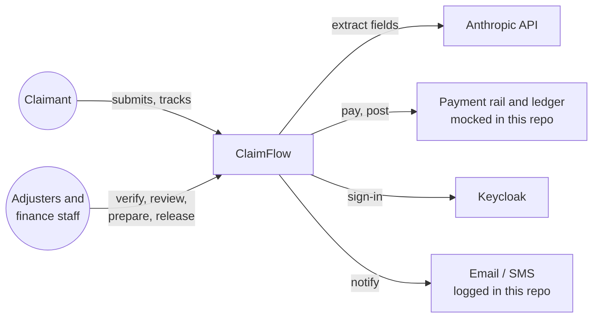
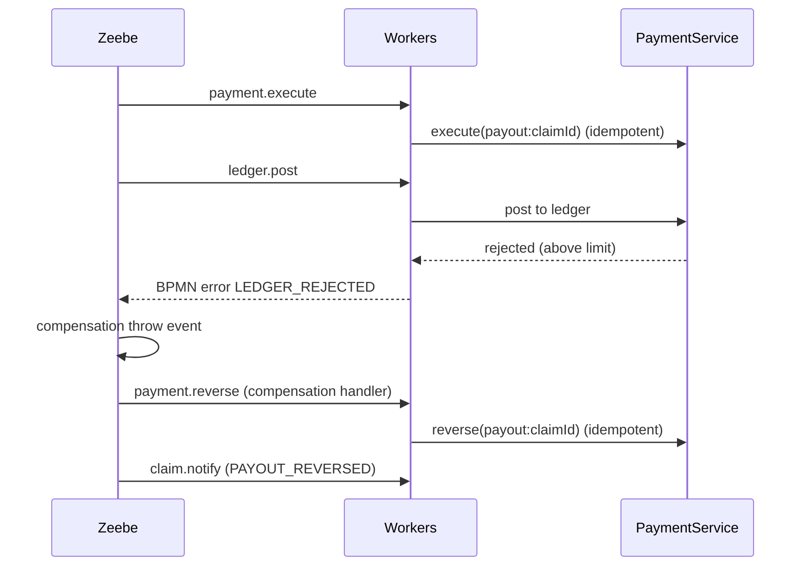
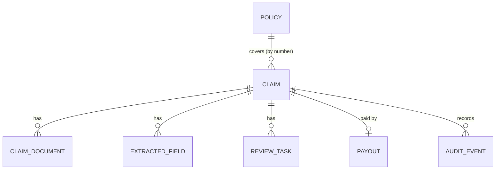

# Architecture

## Context



## Containers

| Container | Responsibility | Talks to |
|-----------|----------------|----------|
| `web` (Next.js) | Claimant portal, staff inbox, claim detail with the live BPMN position | Keycloak (OIDC + PKCE), `api` |
| `api` (Spring Boot) | REST API, job workers, task outbox sweeper | Postgres, Zeebe (gRPC), Keycloak (JWKS), Anthropic |
| `orchestration` (Camunda 8.8) | Zeebe engine, Operate, Tasklist | Elasticsearch |
| `postgres` | Read model, audit log, documents, task outbox | |
| `keycloak` | Users, roles, tokens | |

In production the workers would run as a separate deployment from the REST API, so each scales on its own signal: request rate for the API, job backlog per type for the workers. That's a packaging change, not a code change, because both already live behind separate Spring components.

## Code layout (`backend/src/main/java/dev/claimflow`)

| Package | Contents |
|---------|----------|
| `claim` | Claim aggregate, documents, extracted fields, `ClaimService` (submit, start process, retry) |
| `task` | Human tasks, `TaskService` (roles, maker-checker, validation), `TaskResumer` (outbox) |
| `process` | `ProcessGateway` (the only engine-facing API for app code), `ClaimJobWorkers` (thin adapters), `ClaimSteps` (idempotent step logic) |
| `extraction` | `ExtractionPort`, Claude and rule-based adapters, `FieldNormalizer`, PDF/text reading |
| `policy`, `fraud`, `payment`, `audit` | Policy lookup, explainable fraud rules, idempotent payout and ledger, append-only audit |
| `security`, `web` | Keycloak role mapping, current user, controllers, problem-details errors |

## Key flows

### Completing a human task (the outbox)

```mermaid
sequenceDiagram
    participant U as Staff user
    participant API as TaskService
    participant DB as Postgres
    participant R as TaskResumer
    participant Z as Zeebe
    U->>API: POST /api/tasks/{id}/complete
    API->>API: role check, maker-checker, validate input
    API->>DB: task COMPLETED + resume variables, claim updated, audit (one transaction)
    API-->>U: 200
    Note over API,R: after commit
    R->>Z: publish "task-completed" (correlation key = message id = task id)
    R->>DB: resumed_at = now
    Note over R,Z: if publish fails, the sweeper retries every 15s; duplicates are dropped by message id
```

### Payout with compensation



## Data model



Schema: [V1__schema.sql](../backend/src/main/resources/db/migration/V1__schema.sql). Enumerations are `TEXT + CHECK` rather than Postgres enum types, so migrations stay simple. The claim row has an optimistic-lock version. The process instance key is written with a targeted update, because workers may already be updating the claim by then.

## Scaling and reliability

- **Engine:** Zeebe partitions scale horizontally; this demo runs one broker.
- **Workers:** stateless, so they scale by replica count. Each job type has its own timeout, and extraction gets 2 minutes because it is the slow, expensive step.
- **Retries:** job retries come from the BPMN (3 by default, 5 for payment). When they're exhausted the job becomes an incident, visible in Operate, instead of disappearing.
- **Idempotency:** every worker is safe to repeat ([ADR 5](adr/0005-idempotency-and-the-task-outbox.md)).
- **SLA:** non-interrupting timers escalate stalled verification (8h) and review (48h) without cancelling the task.
